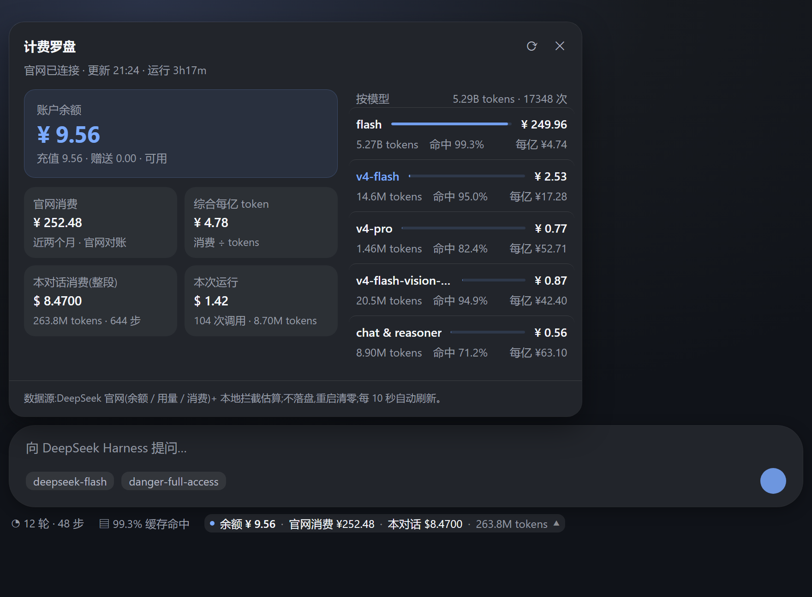

<div align="center">

# 计费罗盘 · Billing Compass

**DeepSeek Harness 的账单面板** — 余额、官网用量与消费、按模型花费、**智能体团队/子代理消费**、实时费用估算,一屏看清。


</div>



> 面板固定在输入框上方、与输入框同宽（portal 到 `document.body`，不受输入框容器裁剪），**不阻塞输入、不写入任何日志**。

---

## 功能

| 指标 | 说明 | 数据来源 |
|---|---|---|
| **账户余额** | 充值 / 赠送 / 可用状态；已登录 DSH 账号时可「允许自动获取」 | `api.deepseek.com/user/balance` 或 DSH 账号 |
| **官网消费** | 近两个月官网对账金额（人民币） | `platform.deepseek.com` 导出 zip 内的 `cost-*.csv` |
| **综合每亿 token** | 官网消费 ÷ tokens | 官网消费与用量对账 |
| **按模型** | 各模型 tokens、缓存命中率、消费、每亿 token 单价 | `platform.deepseek.com/api/v0/usage/amount` |
| **本对话消费（整段）** | 当前会话 + 全部子代理/智能体团队成员的会话日志汇总 | 本地会话日志（只读解析） |
| **智能体团队 / 子代理** | 每个成员的消费、调用次数、tokens、状态与嵌套路径 | `ctx.subagents.listDescendants` + 会话日志 |
| **本次运行** | Harness 进程内所有模型调用的实时估算（含团队） | 拦截 `llm/stream` 的 usage |
| **更新检测** | 发现新版本时提示升级命令 | npm `dist-tags` |

- **所有金额统一以人民币「¥」显示**：内部估算按 USD 单价计算，再按 `usdToCny`（默认 `7.1`）折算；官网返回 CNY 时原样展示。
- 面板每 10 秒自动刷新；会话日志在后台增量解码，不阻塞请求路径。
- 官网用量与消费需要平台登录 token（默认凭据名 `DEEPSEEK_USER_TOKEN`）；未配置时只显示余额与本地统计。

## 智能体团队协作（Agent Teams）

DSH 0.2.1-rc.2 起，Agent Teams 的队友就是**标准 subagent**（同一棵 subagent tree、标准 Session id），因此计费罗盘按同一份 catalog 统计：

- 递归读取当前根会话下所有子代理/团队成员（含嵌套层级），把每个子会话日志里的 usage **并入「本对话消费（整段）」**
- 面板右侧新增「智能体团队」列表：**名称 / 路径或状态 / 调用次数 / tokens / 费用**，按费用倒序，最多显示 8 个成员
- 兼容 0.2.2-alpha.3 起的第 3 版 subagent catalog：优先显示短名称（`reviewer` 等），历史子代理回退到 label/Session id
- subagent 目录不可用时回退扫描会话日志头里的 `parentSession`，仍能统计整棵树
- 「本次运行」天然包含团队所有模型调用（进程级拦截）

## 兼容性

| 依赖 | 要求 | 说明 |
|---|---|---|
| DeepSeek Harness | **0.2.x**（已在 0.2.2-rc.3 验证） | 使用 `conversation.composer.dock`、`workspaceRegistry`、`subagents`、`webServer` |
| Node | ≥ 20 | — |
| Node | ≥ 22.15 | 需要 `zlib.zstdDecompressSync` 才能解析本地会话日志；更低版本只显示实时统计 |
| 系统 | Windows / macOS / Linux | 面板 portal 到 body，并声明 `data-window-drag-exclude` |
| 凭据 | `DEEPSEEK_API_KEY`（余额）/ `DEEPSEEK_USER_TOKEN`（官网） | 都通过 Harness `credentials` 读取 |

## 安装

### 从 npm / 插件市场

```bash
dsh plugin add dsh-billing-compass
```

或在 Harness「设置 → 插件」的插件市场里搜索 `dsh-billing-compass`。

### 本地开发版

```bash
dsh plugin add link:<本目录绝对路径>
```

安装后重启 Harness，刷新页面即可在输入框上方看到统计条。

## 配置（全部可选）

```yaml
- insert:
    - id: dsh-billing-compass
      name: dsh-billing-compass
      config:
        balanceKeyRef: DEEPSEEK_API_KEY      # 余额凭据名
        platformTokenRef: DEEPSEEK_USER_TOKEN # 官网用量/消费凭据名
        balanceIntervalMs: 30000             # 余额刷新间隔
        officialIntervalMs: 300000           # 官网用量/消费刷新间隔
        retryIntervalMs: 30000               # 失败重试间隔
        sessionLog: true                     # 是否解析本地会话日志
        usdToCny: 7.1                        # 内部 USD 估算折算人民币的汇率
        updateCheck: true                    # 是否检查新版本
        updateCheckIntervalMs: 21600000      # 6 小时
        pricing:                             # 覆盖内置单价（USD / 1M tokens）
          deepseek-v4-flash:
            input: 0.28
            cacheHit: 0.028
            output: 0.42
```

## 隐私与安全

- 余额、官网用量、消费只在本机内存中处理，不写入插件日志
- 凭据通过 Harness `credentials` 解析，插件不落盘、不上传
- DSH 账号自动获取余额需要用户在面板里点「允许自动获取」，记录在浏览器本地
- 会话日志只读解析，不改写任何文件

## 更新日志

### 1.0.8

- **适配 DSH 0.2.2-rc.3**：`subagents.listDescendants` 使用规范 Session id（带 `session-` 前缀），恢复第 3 版 catalog 的 `name/path/depth/mode/activity` 字段
- **智能体团队明细**：新增「智能体团队」成员列表（名称、路径、状态、调用次数、tokens、费用），合计仍并入「本对话消费（整段）」
- **金额统一 ¥**：所有 `$` 展示改为 `¥`；内部 USD 估算按 `usdToCny`（默认 7.1）折算，官网 USD 返回同样折算
- 面板与触发条声明 `data-window-drag-exclude`，适配 macOS Desktop 窗口拖拽区域新规则
- 修复 README/package.json 描述的历史编码损坏

### 1.0.7

- 更新检测：启动 5s 后 + 每 6 小时查 npm dist-tags，发现新版本时面板出现更新卡片与「vX.Y.Z 可更新」徽标

### 1.0.6

- 「本对话消费（整段）」纳入子代理/子智能体会话；新增子代理指标与「含 N 个子代理」提示

### 1.0.5 / 1.0.4 / 1.0.3 / 1.0.2 / 1.0.1 / 1.0.0

- 修复面板被输入框容器裁剪、主题变量丢失、标题居中/宽度回退等布局问题
- 首次安装的「自动获取余额」同意卡片 + 动画
- 初始版本：余额、官网用量/消费、按模型、实时统计

## 开发与测试

```bash
npm run check   # node --check 两个入口
npm test        # 10 项零依赖自检（宿主路由 + 客户端渲染 + 市场索引）
```

市场索引：`market/index.json`（format 1，`source.type: npm`）。

## License

MIT
