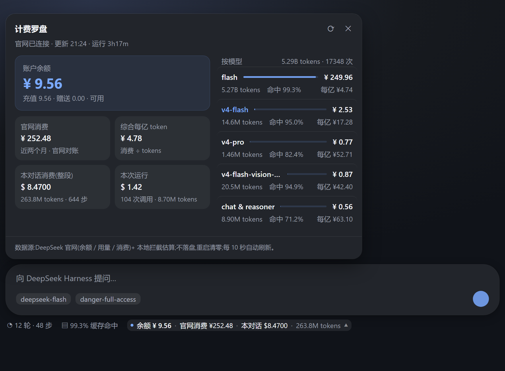
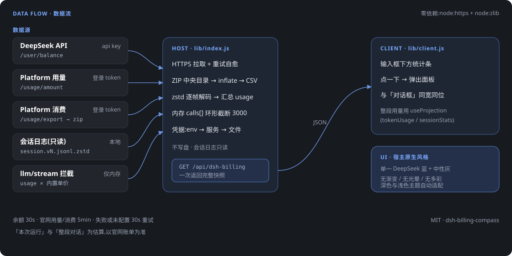

<div align="center">

# 璁¤垂缃楃洏 路 Billing Compass

**DeepSeek Harness 鐨勮处鍗曢潰鏉?* 鈥斺€?浣欓銆佸畼缃戠敤閲忎笌娑堣垂銆佹寜妯″瀷鑺辫垂銆佸疄鏃惰垂鐢ㄤ及绠?涓€灞忕湅娓呫€?


</div>



> 棰勮鍥炬寜鎻掍欢**鐪熷疄 CSS + 瀹夸富鐪熷疄涓婚浠ょ墝**娓叉煋,鏁版嵁涓虹ず渚嬪€笺€?
---

## 瀹冩樉绀轰粈涔?
缁熻鏉″父椹诲湪杈撳叆妗嗕笅鏂?鐐逛竴涓嬪脊鍑洪潰鏉?

| 鍖哄煙 | 鍐呭 | 鏁版嵁鏉ユ簮 |
|---|---|---|
| **璐︽埛浣欓** | 鍏呭€?/ 璧犻€?/ 鏄惁鍙敤 | `api.deepseek.com/user/balance` |
| **瀹樼綉娑堣垂** | 鏈€杩戜袱涓湀娑堣垂鍚堣,鎸夋ā鍨嬫媶鍒?| `platform.deepseek.com/api/v0/usage/export`(zip 鍐?`cost-*.csv`) |
| **缁煎悎姣忎嚎 token** | 瀹樼綉娑堣垂 梅 tokens | 鐢变笂闈袱椤规帹瀵?|
| **鎸夋ā鍨?* | tokens銆佺紦瀛樺懡涓巼銆佹秷璐广€佹瘡浜?token 鍗曚环銆佹秷璐瑰崰姣旀潯 | `platform.deepseek.com/api/v0/usage/amount` |
| **鏈璇濇秷璐?鏁存)** | 鏁翠釜浼氳瘽浠庡紑濮嬪埌鐜板湪鐨勪及绠楄垂鐢?| 鍙瑙ｆ瀽鏈湴浼氳瘽鏃ュ織 |
| **鏈杩愯** | 鏈杩涚▼鍚姩浠ユ潵鐨勮皟鐢ㄦ鏁?/ tokens / 浼扮畻璐圭敤 | 鏈湴鎷︽埅 `llm/stream` 鐨?usage |

- 瑙﹀彂琛?`鈼?浣欓 楼9.56 路 瀹樼綉娑堣垂 楼252.48 路 鏈璇?$8.47 路 263.8M tokens 鈻糮
- 闈㈡澘瀹藉害涓庝綅缃?*涓庤緭鍏ユ鍗＄墖瀹屽叏涓€鑷?*(鍚屽乏銆佸悓瀹姐€佽创鍦ㄨ緭鍏ユ涓婃柟 10px),涓嶆槸娴湪涓棿鐨勭獎鏉?绐楀彛缂╂斁銆佽緭鍏ユ鍙橀珮鏃跺疄鏃惰窡闅?- 闈㈡澘閫氳繃 portal 鎸傚湪 `document.body` 涓?涓嶄細琚?composer 瀹瑰櫒鐨?transform/overflow 瑁佸垏(1.0.1 淇)
- 褰撳墠姝ｅ湪浣跨敤鐨勬ā鍨嬩細鍦ㄥ垪琛ㄩ噷楂樹寒(D 鍝佺墝钃?

## 鏁版嵁娴?


鍏抽敭鐐?

- **闆朵緷璧?*:HTTP 鐢?`node:https`,ZIP 瑙ｅ帇涓?zstd 瑙ｇ爜鐢?`node:zlib`;涓嶉渶瑕?`curl`銆乣pwsh`銆乣unzip` 鎴栦换浣?npm 鍖?- **涓嶈惤鐩?*:瀹炴椂璋冪敤璁板綍鍙瓨鍦ㄥ唴瀛?鏈€杩?3000 鏉?,杩涚▼閲嶅惎鍗虫竻闆?浼氳瘽鏃ュ織鍙
- **鍑嵁涓夌骇鍥為€€**:鐜鍙橀噺 鈫?Harness `credentials` 鏈嶅姟 鈫?`<DSH_HOME>/.credentials.yaml`
- **澶辫触鑷剤**:瀹樼綉鎺ュ彛鍋跺彂澶辫触鎴栧嚟鎹悗琛ユ椂,30 绉掍竴娆¤嚜鍔ㄩ噸璇?涓嶇敤绛?5 鍒嗛挓

---

## 鐜瑕佹眰

| 椤圭洰 | 瑕佹眰 | 涓嶆弧瓒虫椂浼氭€庢牱 |
|---|---|---|
| DeepSeek Harness | **0.2.x**(闇€瑕?`conversation.composer.dock` 妲戒綅涓?`useProjection`) | 闈㈡澘涓嶅嚭鐜?|
| Node | 鈮?20 | 鈥?|
| Node | **鈮?22.15**(鍐呯疆 `zlib.zstdDecompressSync`) | "鏈璇濇秷璐?鏁存)" 閫€鍖栦负"鏈杩愯" |
| 骞冲彴 | Windows / macOS / Linux 鍧囧彲 | 鈥?|
| 鍑嵁 | `DEEPSEEK_API_KEY` 蹇呴渶;`DEEPSEEK_USER_TOKEN` 鍙€?| 閫愰」鏄剧ず"鏈厤缃?,鍏跺畠鏁版嵁鐓у父 |

## 瀹夎

### 鏂瑰紡涓€:npm(鎺ㄨ崘)

[](https://www.npmjs.com/package/dsh-billing-compass)

```bash
dsh plugin add dsh-billing-compass
```

鎴栧湪 Harness 閲?

```
plugin_manager  action=install_bundle  target=dsh-billing-compass
```

鍥藉唴缃戠粶浼氳嚜鍔ㄨ蛋宸插悓姝ョ殑 `registry.npmmirror.com`銆傝瀹?*閲嶅惎 Harness**銆?
### 鏂瑰紡浜?棰勬瀯寤哄寘(鏃犻渶 npm)

浠?[Releases](https://github.com/wwu328763-netizen/dsh-billing-compass/releases/latest) 涓嬭浇 `dsh-billing-compass.tgz`,鐒跺悗:

```
plugin_manager  action=install_bundle  target=<涓嬭浇鍚庣殑 tgz 缁濆璺緞>
```

鎴栫洿鎺ョ粰瀹?URL:

```
plugin_manager  action=install_bundle  target=https://github.com/wwu328763-netizen/dsh-billing-compass/releases/latest/download/dsh-billing-compass.tgz
```

### 鏂瑰紡涓?浠庢簮鐮佺洰褰曡

```bash
git clone https://github.com/wwu328763-netizen/dsh-billing-compass.git
```

```
plugin_manager  action=install_bundle  target=<鍏嬮殕涓嬫潵鐨勭粷瀵硅矾寰?
```

### 鏂瑰紡鍥?鎵嬪伐鏀剧疆

1. 澶嶅埗鏁翠釜鐩綍鍒?`<DSH_HOME>/profiles/node_modules/dsh-billing-compass/`
2. 鍦?*褰撳墠鐢熸晥 profile** 鐨?`cordis.patch.yml` 杩藉姞:

```yaml
- insert:
    - id: dsh-billing-compass
      name: dsh-billing-compass
      config: {}
```

3. 鎶?`dsh-billing-compass` 鍐欒繘鍚岀洰褰?`package.json` 鐨?`dependencies`
4. **閲嶅惎 Harness**,鍐嶅埛鏂伴〉闈?Ctrl+F5)

> 瀹夸富鐨?JS 妯″潡鍦ㄨ繘绋嬪唴琚紦瀛?**鏀逛唬鐮佹垨棣栨瀹夎閮藉繀椤婚噸鍚?*;瀹㈡埛绔敼鍔ㄥ埛鏂伴〉闈㈠嵆鍙€?
### 鏂瑰紡浜?閫氳繃銆屾彃浠跺競鍦?/ Discover銆嶆坊鍔?
鏈粨搴撹嚜甯︿竴浠?**format 1** 甯傚満绱㈠紩,鍔犺繘浠讳綍浜虹殑鎻掍欢甯傚満鍗冲彲鐪嬪埌骞跺畨瑁呮湰鎻掍欢:

```
https://raw.githubusercontent.com/wwu328763-netizen/dsh-billing-compass/main/market/index.json
```

1. 鍚敤瀹為獙鎬у競鍦?bundle `@deepseek-ai/dsh-experimental-plugin-market-bundle`(榛樿鍏抽棴)
2. 璁剧疆 鈫?鎻掍欢 鈫?**Discover** 鈫?娣诲姞绱㈠紩,绮樿创涓婇潰鐨勫湴鍧€
3. 鍦ㄦ湰鎻掍欢鏉＄洰涓婄偣瀹夎(绱㈠紩閲岀殑 1.0.1 璧?npm 閫氶亾,搴曞眰鏄?`dsh-billing-compass@1.0.1`;涔熸敮鎸?commit-pinned 鐨?git 婧?
4. **閲嶅惎 Harness**

> DSH 鐩墠**娌℃湁闆嗕腑鎵樼鐨勫畼鏂瑰競鍦?*:market 鍙槸涓€涓?璇荤储寮?鐨勫鎴风,绱㈠紩璋佹墭绠￠兘琛屻€?> 鏈粨搴撶殑 `market/index.json` 灏辨槸涓€浠界幇鎴愮储寮?浣犲彲浠?fork 鍚庣淮鎶よ嚜宸辩殑绱㈠紩銆?
## 閰嶇疆鍑嵁

涓や釜閿啓鍦?`<DSH_HOME>/.credentials.yaml`,鎴栫敤鍚屽悕鐜鍙橀噺銆?
### `DEEPSEEK_API_KEY` 鈥斺€?浣欓

鍒?[platform.deepseek.com/api_keys](https://platform.deepseek.com/api_keys) 鍒涘缓,`sk-` 寮€澶淬€?
### `DEEPSEEK_USER_TOKEN` 鈥斺€?瀹樼綉鐢ㄩ噺涓庢秷璐?鍙€?

杩欐槸**鐧诲綍鎬?token**,涓嶆槸 API key,闇€瑕佽嚜宸变粠娴忚鍣ㄥ彇:

1. 娴忚鍣ㄧ櫥褰?<https://platform.deepseek.com>
2. `F12` 鈫?Application / 搴旂敤 鈫?Local Storage 鈫?`https://platform.deepseek.com`
3. 鎵?`userToken`,澶嶅埗鍏跺€?閫氬父 64 浣?

```yaml
version: 1
refs:
  DEEPSEEK_API_KEY: sk-xxxxxxxxxxxxxxxx
  DEEPSEEK_USER_TOKEN: xxxxxxxxxxxxxxxxxxxxxxxxxxxxxxxxxxxxxxxxxxxxxxxxxxxxxxxxxxxxxxxx
```

> 杩欐槸瀹樼綉鍐呴儴鎺ュ彛,鍙兘闅忓畼缃戞敼鐗堝け鏁堛€傚け鏁堟椂鍙細褰卞搷"瀹樼綉鐢ㄩ噺/娑堣垂"涓ゅ潡,浣欓涓庢湰鍦扮粺璁′笉鍙楀奖鍝嶃€?
## 鍙€夐厤缃?
```yaml
- insert:
    - id: dsh-billing-compass
      name: dsh-billing-compass
      config:
        balanceKeyRef: DEEPSEEK_API_KEY       # 鎹㈡垚鑷繁鐨勫嚟鎹悕
        platformTokenRef: DEEPSEEK_USER_TOKEN
        balanceIntervalMs: 30000              # 浣欓鍒锋柊
        officialIntervalMs: 120000            # 瀹樼綉鐢ㄩ噺/娑堣垂鍒锋柊(骞惰鎷夊彇)
        retryIntervalMs: 30000                # 澶辫触/鏈厤缃椂鐨勯噸璇?        sessionLog: true                      # 鍏虫帀鍒欎笉瑙ｆ瀽鏈湴浼氳瘽鏃ュ織
        pricing:                              # 鍗曚环瑕嗙洊,USD / 1M tokens
          deepseek-v4-flash: { input: 0.28, cacheHit: 0.028, output: 0.42 }
          deepseek-v4-pro:   { input: 0.55, cacheHit: 0.14,  output: 2.19 }
```

## 鎬ц兘璁捐

闈㈡澘鎵撳紑鍒板嚭鏁版槸**姣绾?*,闈犱笁鏉＄害鏉?

| 鎺柦 | 鏁堟灉(鏈満瀹炴祴) |
|---|---|
| **瀹樻柟鎺ュ彛骞惰**,涓嶅啀涓茶 | 4 涓姹?鐢ㄩ噺脳2 + 娑堣垂脳2):1282ms 鈫?**904ms**(鍐?TLS;鐑繛鎺ユ洿浣? |
| **HTTPS keep-alive 杩炴帴姹?* | 浣欓姣?30s 涓€娆?璺宠繃閲嶅 TLS 鎻℃墜 |
| **鍑嵁瑙ｆ瀽缂撳瓨**(30s) | 璺敱涓庢姄鍙栦笉鍐嶉噸澶嶈 `.credentials.yaml` / 闂?credentials 鏈嶅姟 |
| **浼氳瘽鏃ュ織绉诲嚭璇锋眰璺緞** | 璺敱鍝嶅簲 **0鈥?ms**;鏃ュ織鐢卞悗鍙伴棿闅斿閲忓埛鏂?|
| **闈㈡澘浣嶇疆璁＄畻鑺傛祦** | 婊氬姩/缂╂斁鏃?rAF 鍚堝苟 + 鍧愭爣鏈彉涓嶉噸娓叉煋 |
| **鍚庡彴椤垫殏鍋滆疆璇?* | 椤甸潰涓嶅彲瑙佹椂鍋滄 10s 杞,鍒囧洖鍓嶅彴绔嬪埢琛ヤ竴娆?|

浼氳瘽鏃ュ織鏄?*鍙拷鍔?*鐨勫甯?zstd 娴?鍥犳:

- 棣栨鍏ㄩ噺瑙ｆ瀽(绾?4MB 鈫?20MB 鏂囨湰,~175ms),涔嬪悗**鍙В鐮佹柊澧炵殑甯?*,闀夸細璇濅笉浼氳秺璺戣秺鎱?- 璺敱鍙缂撳瓨鍊?缂撳瓨杩囨湡鏃?*涓㈠埌鍚庡彴鍒锋柊**,姘镐笉闃诲鍝嶅簲
- 鏂囦欢琚疆杞?缂╃煭鏃惰嚜鍔ㄩ噸鏂板叏閲忚В鏋?
## 璁＄畻鍙ｅ緞

```
鍗曟/鏁存璐圭敤 鈮?(鏈紦瀛樿緭鍏?+ 缂撳瓨鍐? 脳 input
              + 缂撳瓨璇?脳 cacheHit
              + 杈撳嚭 脳 output            锛堝崟浣?USD / 1M tokens锛?
姣忎嚎 token 娑堣垂 = 娑堣垂閲戦 梅 (tokens 梅 100,000,000)
缁煎悎姣忎嚎 token = 瀹樼綉娑堣垂鍚堣 梅 (瀹樼綉 tokens 梅 100,000,000)
```

- **瀹樼綉鏁版嵁**浠ュ畼缃戜负鍑?浣嗗彲鑳芥湁鏁板皬鏃跺欢杩?涓斿彧瑕嗙洊鏈€杩戠害涓や釜鏈?- **鏈杩愯 / 鏁存瀵硅瘽**鏄寜鍐呯疆鍗曚环琛ㄧ殑**浼扮畻**,涓庡畼缃戣处鍗曚細鏈夊亸宸?缂撳瓨璁¤垂鍙ｅ緞銆侀噸璇曡姹傘€佸崟浠峰彉鍔ㄧ瓑)
- 妯″瀷鍚嶅尮閰嶄笉鍒板崟浠疯〃鏃?鍚?`flash` 鎸?flash 浠枫€佸惈 `pro`/`reasoner` 鎸?pro 浠?鍏朵綑鐢ㄩ粯璁や环

## 闅愮

- 涓嶅啓浠讳綍鏂囦欢;涓嶉噰闆嗐€佷笉涓婁紶浠讳綍鍐呭
- 瀹炴椂缁熻鍙湪鍐呭瓨,閲嶅惎娓呴浂
- 浼氳瘽鏃ュ織**鍙**(姹囨€?token 鐢ㄩ噺),涓嶄慨鏀?- 鍞竴澶栭儴璇锋眰鏄?DeepSeek 瀹樻柟涓変釜鎺ュ彛

## 甯歌闂

| 鐜拌薄 | 澶勭悊 |
|---|---|
| 缁熻鏉￠噷娌℃湁"浣欓 鈥? | 鏈鎴愬姛鎴栨湭閲嶅惎;妫€鏌?profile 鐨?`cordis.patch.yml` 涓?`profiles/node_modules` |
| 鏄剧ず"浣欓 鏈厤缃? | 缂?`DEEPSEEK_API_KEY` |
| "瀹樼綉娑堣垂/鐢ㄩ噺 鏈厤缃? | 缂?`DEEPSEEK_USER_TOKEN`(鍙€夊姛鑳? |
| 瀹樼綉鏁版嵁"鑾峰彇澶辫触 HTTP 401" | token 杩囨湡,閲嶆柊鍙栦竴娆?|
| "鏈璇濇秷璐?鏁存)" 涓?鏈杩愯"鐩稿悓 | Node < 22.15 涓嶆敮鎸?zstd,鎴?`sessionLog: false` |
| 闈㈡澘浣嶇疆/瀹藉害涓嶅 | 璇?Harness 鐗堟湰鐨勮緭鍏ユ DOM 鍙樹簡,娆㈣繋鎻?issue 骞堕檮鐗堟湰鍙?|
| 鏀逛簡浠ｇ爜涓嶇敓鏁?| 瀹夸富妯″潡琚紦瀛?**閲嶅惎 Harness**;瀹㈡埛绔敼鍔ㄥ埛鏂伴〉闈?|
| 闈㈡澘浣嶇疆/瀹藉害浠嶄笉瀵?| 1.0.1 宸查€傞厤 0.2.2-rc.1;鑻ユ洿鏃?鏇存柊鐨?Harness 鏀逛簡杈撳叆妗?DOM,闄勭増鏈彿鎻?issue |

## 鐩綍缁撴瀯

```
lib/index.js       瀹夸富:HTTPS 鎶撳彇銆乑IP/CSV銆亃std 浼氳瘽鏃ュ織銆?api/dsh-billing 璺敱
lib/client.js      瀹㈡埛绔?缁熻鏉?+ 鐐瑰嚮寮瑰嚭闈㈡澘(React.createElement,鏃犳瀯寤?
cordis.patch.yml   bundle 娉ㄥ唽琛?鍚彲閫夐」璇存槑)
locale/{en,zh}.json  鎻掍欢绠＄悊閲屾樉绀虹殑鏍囬涓庢弿杩?icon.svg           搴旂敤鍥炬爣
docs/              README 鐢ㄥ浘
tools/smoke.mjs    闆朵緷璧栬嚜妫€(瀹夸富璺敱 + 瀹㈡埛绔敞鍐?+ 甯傚満绱㈠紩妫€鏌?
tools/serve-market-index.mjs  鏈湴甯傚満绱㈠紩鏈嶅姟(璺緞鐩稿浠撳簱,鍙洿鎺ヨ繍琛?
market/            format 1 甯傚満绱㈠紩涓?awesome-list 鏉＄洰
```

璋冭瘯鍥句腑鏁版嵁:`GET http://127.0.0.1:<port>/api/dsh-billing?sessionId=<id>` 鐩存帴杩斿洖瀹屾暣蹇収銆?
## 寮€鍙戜笌鑷

```bash
npm run check   # node --check 涓や釜鍗婅竟鐨勮娉?npm test        # 绂荤嚎鑷:瀹夸富 apply/璺敱蹇収銆佸鎴风妯″潡娉ㄥ唽銆佸競鍦虹储寮曞瓧娈?node tools/serve-market-index.mjs   # 鏈湴璧峰競鍦虹储寮?缁?Discover 娣诲姞 http://127.0.0.1:8799/index.json
```

鑷涓嶈仈缃戙€佷笉璇荤湡瀹炲嚟鎹?涓存椂鎶?`DSH_HOME` 鎸囧悜绌虹洰褰?,鍙互鍦?CI 閲岃窇銆?
## 鏇存柊鏃ュ織

### 1.0.2

- **修复 1.0.1 回归**：panel 用 portal 挂到 `document.body` 后，只声明在 `.dskc-anchor` 上的主题变量（品牌蓝、文字色、描边、hover）不再继承进面板，导致面板变成全灰白；现在变量同时挂在 `.dskc-panel` 上
- 恢复品牌蓝点缀：余额主指标、消费占比条、当前模型高亮、卡片描边

### 1.0.1

- **宸插彂甯冨埌 npm**:`dsh-billing-compass@1.0.1`(鏈€鏂扮増),甯傚満绱㈠紩 1.0.1 鍚屾鎸囧悜 npm 閫氶亾
- **淇闈㈡澘瀹氫綅**:鏀圭敤 `react-dom` 鐨?`createPortal` 鎸傚埌 `document.body`,闈㈡澘涓嶅啀琚?composer 瀹瑰櫒鐨?`transform/overflow` 鍋忕Щ鎴栬鍒?浠ュ涓荤ǔ瀹氱殑 `[data-composer-card]` 閲忓彇杈撳叆妗嗗崱鐗?鍋氬埌鍚屽乏銆佸悓瀹姐€佷笂鏂?10px,骞惰窡闅忚緭鍏ユ/绐楀彛灏哄鍙樺寲
- 鎵撳紑鍓嶅厛绠椾綅缃?閬垮厤棣栧抚闂幇;浣嶇疆璁＄畻鐢?rAF 鍚堝苟銆佸潗鏍囦笉鍙樻椂涓嶉噸娓叉煋
- 鍚庡彴鏍囩椤垫殏鍋滆疆璇?鍒囧洖鍓嶅彴绔嬪嵆琛ユ媺;璇锋眰涓嶅彔鍔?鎵嬪姩鍒锋柊澧?busy 鐘舵€?- 閿洏鍙揪鎬?鎵撳紑鏃剁劍鐐硅繘闈㈡澘,Esc 鍏抽棴骞舵妸鐒︾偣杩樼粰瑙﹀彂琛?- 瀹夸富渚?鍑嵁瑙ｆ瀽澧炲姞 30s 缂撳瓨,璺敱璇婃柇涓嶅啀姣忔璇绘枃浠?甯傚満绱㈠紩鏈嶅姟鑴氭湰鏀逛负璺緞鏃犲叧
- 鏂板闆朵緷璧?`npm test` 鑷涓?`npm run check`

### 1.0.0

- 棣栦釜 npm 鐗堟湰:浣欓銆佸畼缃戠敤閲?娑堣垂銆佹寜妯″瀷鑺辫垂銆佹湰娆¤繍琛屼笌鏁存瀵硅瘽璐圭敤浼扮畻

## License

MIT
