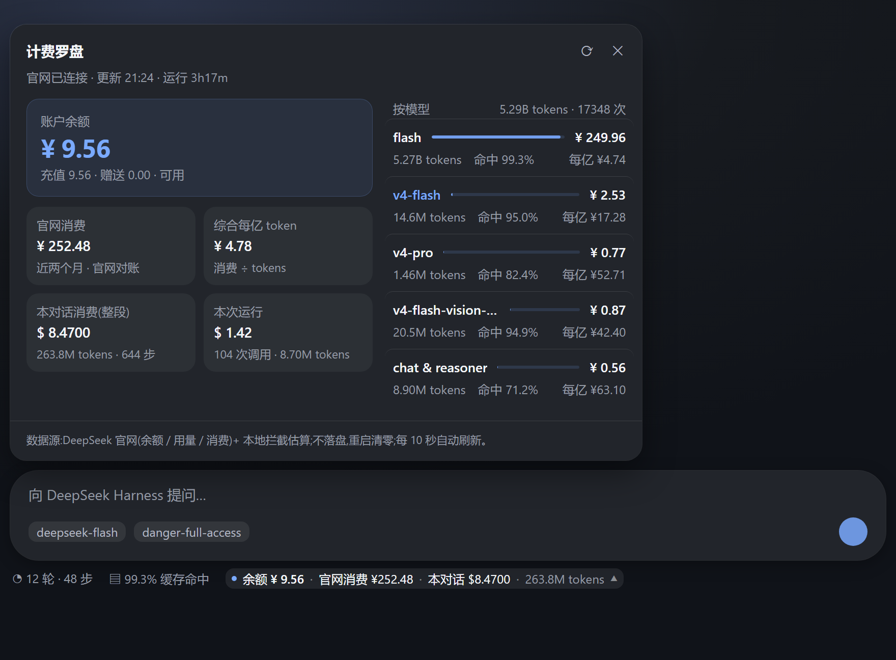
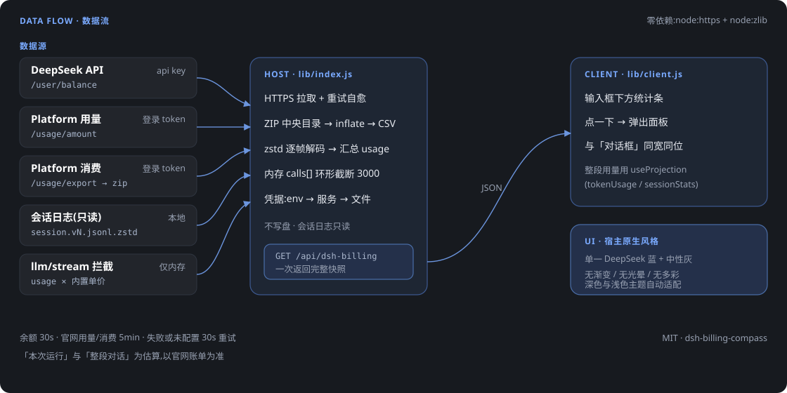

<div align="center">

# 计费罗盘 · Billing Compass

**DeepSeek Harness 的账单面板** —— 余额、官网用量与消费、按模型花费、实时费用估算,一屏看清。


</div>



> 预览图按插件**真实 CSS + 宿主真实主题令牌**渲染,数据为示例值。

---

## 它显示什么

统计条常驻在输入框下方,点一下弹出面板:

| 区域 | 内容 | 数据来源 |
|---|---|---|
| **账户余额** | 充值 / 赠送 / 是否可用 | `api.deepseek.com/user/balance` |
| **官网消费** | 最近两个月消费合计,按模型拆分 | `platform.deepseek.com/api/v0/usage/export`(zip 内 `cost-*.csv`) |
| **综合每亿 token** | 官网消费 ÷ tokens | 由上面两项推导 |
| **按模型** | tokens、缓存命中率、消费、每亿 token 单价、消费占比条 | `platform.deepseek.com/api/v0/usage/amount` |
| **本对话消费(整段)** | 整个会话从开始到现在的估算费用 | 只读解析本地会话日志 |
| **本次运行** | 本次进程启动以来的调用次数 / tokens / 估算费用 | 本地拦截 `llm/stream` 的 usage |

- 触发行:`● 余额 ¥9.56 · 官网消费 ¥252.48 · 本对话 $8.47 · 263.8M tokens ▼`
- 面板宽度与位置**与输入框卡片完全一致**,不是浮在中间的窄条
- 当前正在使用的模型会在列表里高亮(D 品牌蓝)

## 数据流



关键点:

- **零依赖**:HTTP 用 `node:https`,ZIP 解压与 zstd 解码用 `node:zlib`;不需要 `curl`、`pwsh`、`unzip` 或任何 npm 包
- **不落盘**:实时调用记录只存在内存(最近 3000 条),进程重启即清零;会话日志只读
- **凭据三级回退**:环境变量 → Harness `credentials` 服务 → `<DSH_HOME>/.credentials.yaml`
- **失败自愈**:官网接口偶发失败或凭据后补时,30 秒一次自动重试,不用等 5 分钟

---

## 环境要求

| 项目 | 要求 | 不满足时会怎样 |
|---|---|---|
| DeepSeek Harness | **0.2.x**(需要 `conversation.composer.dock` 槽位与 `useProjection`) | 面板不出现 |
| Node | ≥ 20 | — |
| Node | **≥ 22.15**(内置 `zlib.zstdDecompressSync`) | "本对话消费(整段)" 退化为"本次运行" |
| 平台 | Windows / macOS / Linux 均可 | — |
| 凭据 | `DEEPSEEK_API_KEY` 必需;`DEEPSEEK_USER_TOKEN` 可选 | 逐项显示"未配置",其它数据照常 |

## 安装

### 方式一:npm(推荐)

[](https://www.npmjs.com/package/dsh-billing-compass)

```bash
dsh plugin add dsh-billing-compass
```

或在 Harness 里:

```
plugin_manager  action=install_bundle  target=dsh-billing-compass
```

国内网络会自动走已同步的 `registry.npmmirror.com`。装完**重启 Harness**。

### 方式二:预构建包(无需 npm)

从 [Releases](https://github.com/wwu328763-netizen/dsh-billing-compass/releases/latest) 下载 `dsh-billing-compass.tgz`,然后:

```
plugin_manager  action=install_bundle  target=<下载后的 tgz 绝对路径>
```

或直接给它 URL:

```
plugin_manager  action=install_bundle  target=https://github.com/wwu328763-netizen/dsh-billing-compass/releases/latest/download/dsh-billing-compass.tgz
```

### 方式三:从源码目录装

```bash
git clone https://github.com/wwu328763-netizen/dsh-billing-compass.git
```

```
plugin_manager  action=install_bundle  target=<克隆下来的绝对路径>
```

### 方式四:手工放置

1. 复制整个目录到 `<DSH_HOME>/profiles/node_modules/dsh-billing-compass/`
2. 在**当前生效 profile** 的 `cordis.patch.yml` 追加:

```yaml
- insert:
    - id: dsh-billing-compass
      name: dsh-billing-compass
      config: {}
```

3. 把 `dsh-billing-compass` 写进同目录 `package.json` 的 `dependencies`
4. **重启 Harness**,再刷新页面(Ctrl+F5)

> 宿主的 JS 模块在进程内被缓存,**改代码或首次安装都必须重启**;客户端改动刷新页面即可。

### 方式五:通过「插件市场 / Discover」添加

本仓库自带一份 **format 1** 市场索引,加进任何人的插件市场即可看到并安装本插件:

```
https://raw.githubusercontent.com/wwu328763-netizen/dsh-billing-compass/main/market/index.json
```

1. 启用实验性市场 bundle `@deepseek-ai/dsh-experimental-plugin-market-bundle`(默认关闭)
2. 设置 → 插件 → **Discover** → 添加索引,粘贴上面的地址
3. 在本插件条目上点安装(底层是
   `git+https://github.com/wwu328763-netizen/dsh-billing-compass.git#<commit>`)
4. **重启 Harness**

> DSH 目前**没有集中托管的官方市场**:market 只是一个"读索引"的客户端,索引谁托管都行。
> 本仓库的 `market/index.json` 就是一份现成索引,你可以 fork 后维护自己的索引。

## 配置凭据

两个键写在 `<DSH_HOME>/.credentials.yaml`,或用同名环境变量。

### `DEEPSEEK_API_KEY` —— 余额

到 [platform.deepseek.com/api_keys](https://platform.deepseek.com/api_keys) 创建,`sk-` 开头。

### `DEEPSEEK_USER_TOKEN` —— 官网用量与消费(可选)

这是**登录态 token**,不是 API key,需要自己从浏览器取:

1. 浏览器登录 <https://platform.deepseek.com>
2. `F12` → Application / 应用 → Local Storage → `https://platform.deepseek.com`
3. 找 `userToken`,复制其值(通常 64 位)

```yaml
version: 1
refs:
  DEEPSEEK_API_KEY: sk-xxxxxxxxxxxxxxxx
  DEEPSEEK_USER_TOKEN: xxxxxxxxxxxxxxxxxxxxxxxxxxxxxxxxxxxxxxxxxxxxxxxxxxxxxxxxxxxxxxxx
```

> 这是官网内部接口,可能随官网改版失效。失效时只会影响"官网用量/消费"两块,余额与本地统计不受影响。

## 可选配置

```yaml
- insert:
    - id: dsh-billing-compass
      name: dsh-billing-compass
      config:
        balanceKeyRef: DEEPSEEK_API_KEY       # 换成自己的凭据名
        platformTokenRef: DEEPSEEK_USER_TOKEN
        balanceIntervalMs: 30000              # 余额刷新
        officialIntervalMs: 120000            # 官网用量/消费刷新(并行拉取)
        retryIntervalMs: 30000                # 失败/未配置时的重试
        sessionLog: true                      # 关掉则不解析本地会话日志
        pricing:                              # 单价覆盖,USD / 1M tokens
          deepseek-v4-flash: { input: 0.28, cacheHit: 0.028, output: 0.42 }
          deepseek-v4-pro:   { input: 0.55, cacheHit: 0.14,  output: 2.19 }
```

## 性能设计

面板打开到出数是**毫秒级**,靠三条约束:

| 措施 | 效果(本机实测) |
|---|---|
| **官方接口并行**,不再串行 | 4 个请求(用量×2 + 消费×2):1282ms → **904ms**(冷 TLS;热连接更低) |
| **HTTPS keep-alive 连接池** | 余额每 30s 一次,跳过重复 TLS 握手 |
| **会话日志移出请求路径** | 路由响应 **0–1ms**;日志由后台间隔增量刷新 |

会话日志是**只追加**的多帧 zstd 流,因此:

- 首次全量解析(约 4MB → 20MB 文本,~175ms),之后**只解码新增的帧**,长会话不会越跑越慢
- 路由只读缓存值,缓存过期时**丢到后台刷新**,永不阻塞响应
- 文件被轮转/缩短时自动重新全量解析

## 计算口径

```
单次/整段费用 ≈ (未缓存输入 + 缓存写) × input
              + 缓存读 × cacheHit
              + 输出 × output            （单位:USD / 1M tokens）

每亿 token 消费 = 消费金额 ÷ (tokens ÷ 100,000,000)
综合每亿 token = 官网消费合计 ÷ (官网 tokens ÷ 100,000,000)
```

- **官网数据**以官网为准,但可能有数小时延迟,且只覆盖最近约两个月
- **本次运行 / 整段对话**是按内置单价表的**估算**,与官网账单会有偏差(缓存计费口径、重试请求、单价变动等)
- 模型名匹配不到单价表时:含 `flash` 按 flash 价、含 `pro`/`reasoner` 按 pro 价,其余用默认价

## 隐私

- 不写任何文件;不采集、不上传任何内容
- 实时统计只在内存,重启清零
- 会话日志**只读**(汇总 token 用量),不修改
- 唯一外部请求是 DeepSeek 官方三个接口

## 常见问题

| 现象 | 处理 |
|---|---|
| 统计条里没有"余额 …" | 未装成功或未重启;检查 profile 的 `cordis.patch.yml` 与 `profiles/node_modules` |
| 显示"余额 未配置" | 缺 `DEEPSEEK_API_KEY` |
| "官网消费/用量 未配置" | 缺 `DEEPSEEK_USER_TOKEN`(可选功能) |
| 官网数据"获取失败 HTTP 401" | token 过期,重新取一次 |
| "本对话消费(整段)" 与"本次运行"相同 | Node < 22.15 不支持 zstd,或 `sessionLog: false` |
| 面板位置/宽度不对 | 该 Harness 版本的输入框 DOM 变了,欢迎提 issue 并附版本号 |
| 改了代码不生效 | 宿主模块被缓存,**重启 Harness**;客户端改动刷新页面 |

## 目录结构

```
lib/index.js       宿主:HTTPS 抓取、ZIP/CSV、zstd 会话日志、/api/dsh-billing 路由
lib/client.js      客户端:统计条 + 点击弹出面板(React.createElement,无构建)
cordis.patch.yml   bundle 注册行(含可选项说明)
locale/{en,zh}.json  插件管理里显示的标题与描述
icon.svg           应用图标
docs/              README 用图
```

调试图中数据:`GET http://127.0.0.1:<port>/api/dsh-billing?sessionId=<id>` 直接返回完整快照。

## License

MIT
